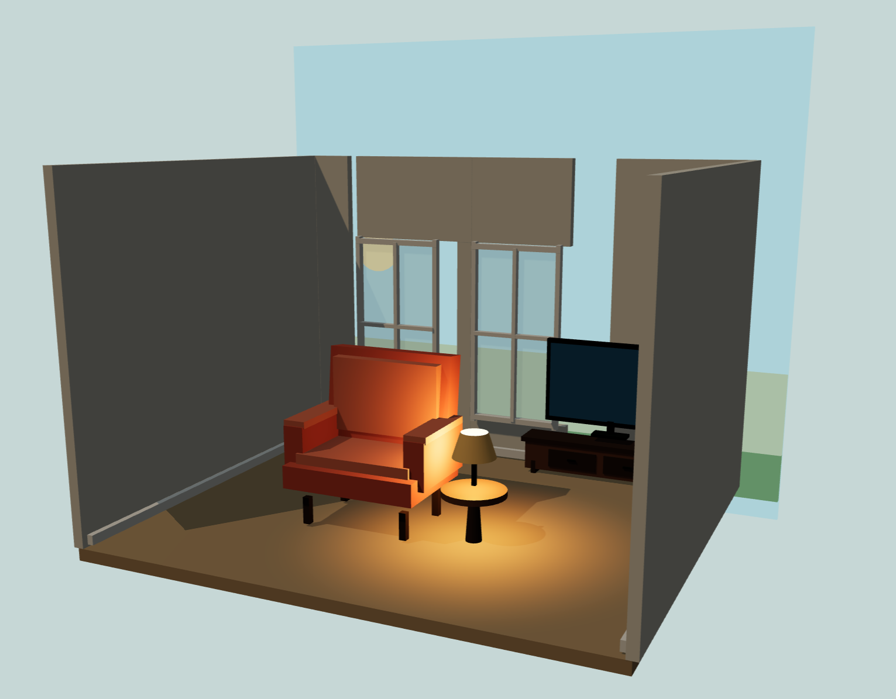
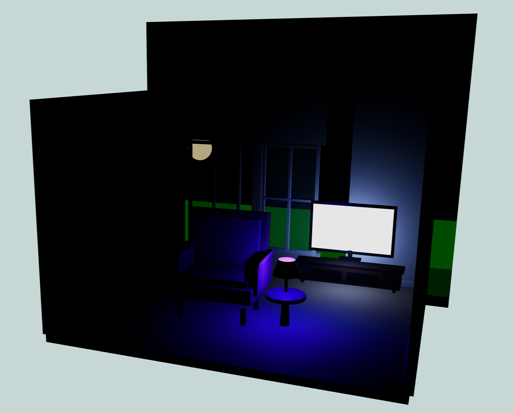
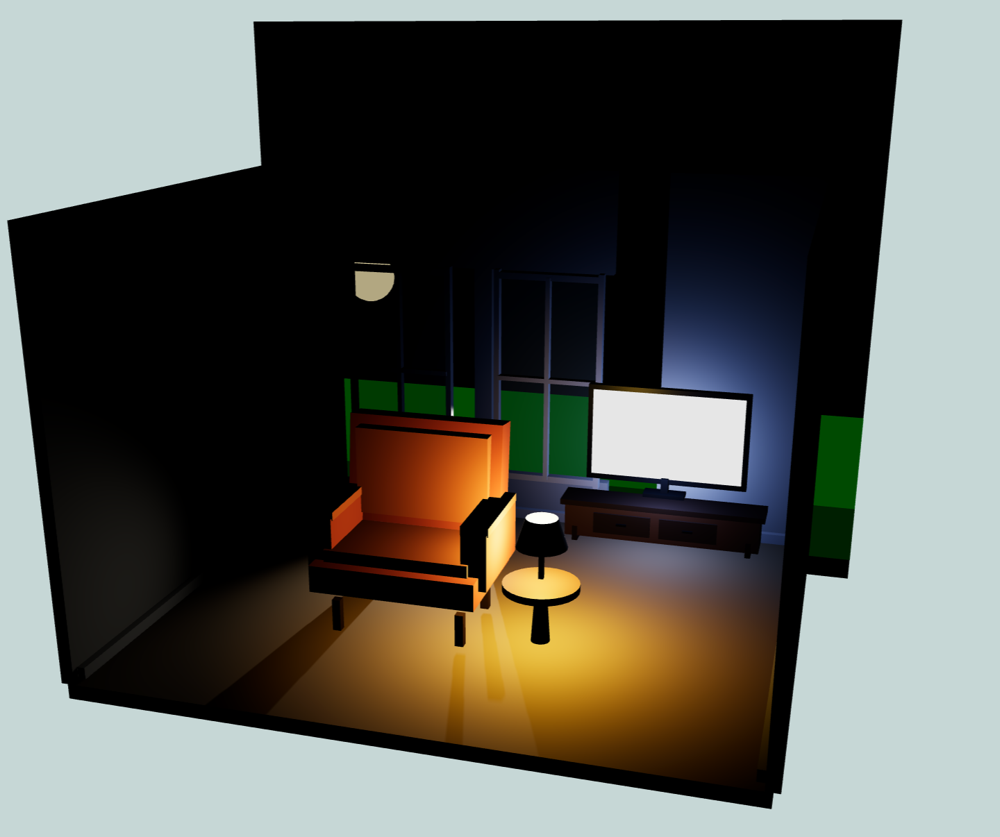
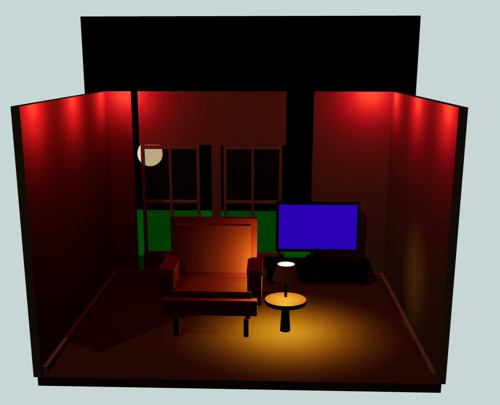

# WebGL Weekly 6

A Three.js living-room scene with an open-front room, upholstered chair, television and console, side table, reading lamp, and two framed windows overlooking a daytime landscape. Orbit around the room to inspect the layout and lighting.

## Reflection questions
1 Which lighting setup created the strongest mood?
Movie night created the strongest mood because I can feel the tension.

2 Which scene felt most realistic?
Storm felt pretty realistic with the combination of lighting from the TV, lamp, and the lightning flashes.

3 How did lighting change the emotional feeling of the room?
Lighting can change the emotional feeling of the room for the better or the worse based on the color, intensity, and distance of the light. 

4 Why are PointLights useful indoors?
PointLights are useful indoors because they are good at recreating a lamp's natural lighting in a digital scene.

5 Why are colored lights effective for storytelling?
Colored lights are effective for storytelling as they help with mood. Warm colors can help create a cozy environment while cooler colors does the opposite.

6 Which lighting setup required the most experimentation?
BossBattle required the most experimentation with getting the correct coordinates for my idea of LED lights in combination with a flickering TV and the lamp.

7 How did animated lights improve the scene?
Animated lights improve the scene by adding story elements to a scene.

8 If this were a real game, which scene would players remember most and why?
Players would most remember the boss battle lighting because of how many different colored lights are on and how they interact with one another.
## Assignment screenshots




## Run locally

Because the project uses JavaScript modules, open it through a local web server instead of opening the HTML file directly.

From the project directory, run:

```bash
python3 -m http.server 8000
```

Then open [http://localhost:8000/weekly6.html](http://localhost:8000/weekly6.html) in a browser.

You can also use the Live Server extension in VS Code.

## Controls

- Drag to orbit around the scene.
- Scroll to zoom.
- Resize the browser window to update the camera and renderer. The scene also adapts to smaller screens.

## Project files

- [`weekly6.html`](weekly6.html) loads the scene and defines the import map for Three.js.
- [`weekly6.js`](weekly6.js) creates the room, furniture, exterior view, lighting, controls, and render loop.

## Technologies

- [Three.js](https://threejs.org/) `0.160.0`
- JavaScript ES modules
- WebGL